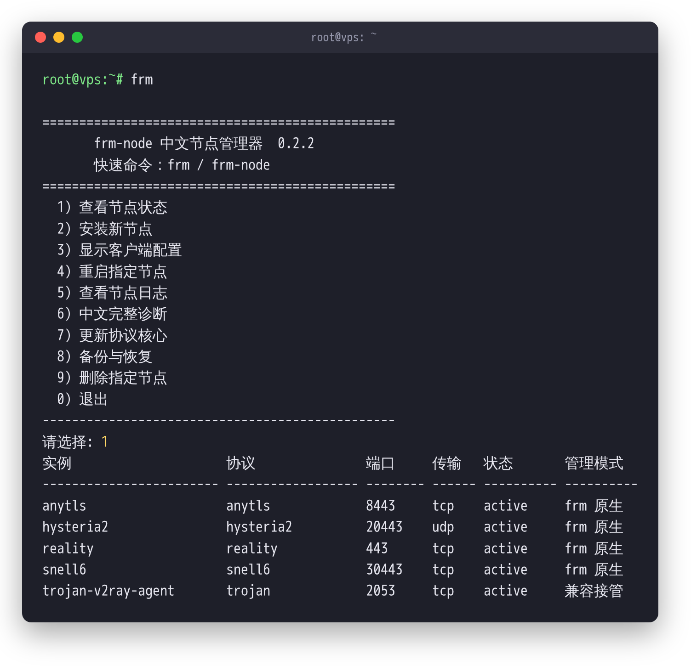

# frm-node

[](https://github.com/godsonkg/frm-node/actions/workflows/test.yml)
[](https://github.com/godsonkg/frm-node/releases/latest)
[](LICENSE)

[简体中文](README.md) | **English**

`frm-node` is a multi-protocol proxy node manager for Debian/Ubuntu VPS hosts. It orchestrates the **official** upstream server cores: their configuration, systemd services, diagnostics and client config export. It does not implement any proxy protocol itself.

Running several hosts? Its sister project [proxyfleet](https://github.com/godsonkg/proxyfleet) manages the whole fleet from one inventory file and builds and publishes the Surge, Loon and Mihomo subscriptions. frm-node manages each server; proxyfleet manages the fleet.

Current version: `0.2.2`. Takeover, monitoring and subscription export have been tested on 6 real VPS hosts. It is still a personal tool and has not been fully validated across distributions and CPU architectures. See [SECURITY.md](SECURITY.md) (Chinese) for the security boundary and known trade-offs.

<p align="center"></p>
<p align="center"><sub>The Chinese menu and the <code>frm status</code> table (demo data)</sub></p>

> **Note:** the interactive menu, prompts and diagnostic output are in Simplified Chinese. All commands and flags are the English ones listed below.

## Highlights

- **No daemon, no listening port, no web panel.** `frm` runs once and exits. The optional monitor runs from a systemd timer and only sends outbound Telegram messages.
- **Official cores only.** Xray-core, anytls-go, Hysteria and Surge's Snell server are downloaded from upstream over HTTPS. Snell archives are pinned by SHA-256 in `versions.env`.
- **Safe adoption of existing nodes.** It can register nodes created by other popular scripts in place, without restarting them or changing their config. A full takeover is backed up and can be rolled back.
- **Clean subscription fragments** for Surge, Loon and Mihomo (Clash Meta), which can be collected from many hosts over SSH.
- **Certificate fingerprint pinning** for protocols that use long-lived self-signed certificates.
- **Guarded core updates**: read-only checks, a dry-run preflight, backups, a post-restart health window and automatic binary rollback.

## Supported protocols

| Protocol | Server implementation | Deployment mode |
|---|---|---|
| VLESS Reality Vision | Xray-core | Native RAW + REALITY |
| AnyTLS | anytls-go | Native TCP |
| Hysteria2 | Official Hysteria | Native UDP, optional Salamander |
| Snell v4 | Official Surge server | Native; optional ShadowTLS v3 |
| Snell v5 | Official Surge server | Native; optional ShadowTLS v3 |
| Snell v6 Beta | Official Surge server | Native only, no ShadowTLS |

TUIC v5, Shadowsocks 2022, NaiveProxy and certificate-based VLESS/Trojan are planned for a later phase. The menu does not show options that are not implemented yet.

## Requirements

- Debian 11+ or Ubuntu 22.04+
- systemd
- `amd64` or `arm64` (Snell also supports some older architectures that upstream ships)
- A public IPv4 address. Open the node ports in your cloud provider's security group as well.

## Installation

Installation requires root. Pin a tag or a full commit SHA, and review the downloaded script first. Following `main` installs whatever the latest commit is at that moment.

```bash
FRM_REF=v0.2.2 bash <(curl -fsSL https://raw.githubusercontent.com/godsonkg/frm-node/v0.2.2/bootstrap.sh)
```

The installer prints the SHA-256 of the install bundle. Record the value from your first trusted install. After that you can set `FRM_SHA256` to enforce it, and the install aborts on any mismatch:

```bash
FRM_REF=v0.2.2 FRM_SHA256="<trusted bundle SHA-256>" bash <(curl -fsSL https://raw.githubusercontent.com/godsonkg/frm-node/v0.2.2/bootstrap.sh)
```

`FRM_SHA256` verifies the install bundle, not `bootstrap.sh` itself.

`FRM_REF` also accepts a branch name or a full commit SHA. To follow the development branch (only if you know what changed):

```bash
bash <(curl -fsSL https://raw.githubusercontent.com/godsonkg/frm-node/main/bootstrap.sh)
```

A safer route is to download and inspect `bootstrap.sh`, then run it as root. For an offline install, upload the full repository directory and run:

```bash
bash install.sh
```

The installer creates two equivalent entry points:

```bash
frm
frm-node
```

If a program named `frm` already exists on the system, the installer does not overwrite it. Use `frm-node` instead.

## Common commands

```bash
frm                         # interactive menu (Chinese)
frm status                  # status of all instances
frm install reality         # install VLESS Reality
frm install anytls          # install AnyTLS
frm install hysteria2       # install Hysteria2
frm install snell4          # install native Snell v4
frm install snell4-shadowtls
frm install snell5
frm install snell5-shadowtls
frm install snell6          # Snell v6 Beta, native only
frm show all                # export client configs
frm doctor                  # full diagnostics
frm logs <instance> --follow
frm update                  # update installed cores after a backup
frm backup
frm restore <backup-file>
frm uninstall <instance>
frm adopt scan              # read-only detection of other scripts and standalone Snell
frm adopt report            # redacted inventory that is safe to share
frm adopt register          # register in place: no restart, no config change
frm adopt forget <instance> # unregister only; the node keeps running
frm adopt takeover          # full control-plane takeover after a backup
frm adopt takeover-status   # takeover status and backup verification
frm adopt rollback          # roll back the latest takeover
frm watch setup             # configure Telegram monitoring
frm watch status            # monitor status (token masked)
frm watch test              # send a test message
frm watch accept-ports      # accept the current listening ports as the baseline
frm watch accept-cron       # accept the current root crontab as the baseline
frm watch off / on          # disable / enable scheduled checks
frm sub fragment            # generate clean Surge/Loon/Mihomo fragments
frm sub check               # generate and check permissions, structure, counts, skips (redacted)
frm sub status              # fragment file status
frm cert scan               # certificate pinning status
frm cert pin all            # pin every supported instance
```

## Adopting existing nodes

frm-node currently recognizes [`mack-a/v2ray-agent`](https://github.com/mack-a/v2ray-agent), `chil30-group/vless-all-in-one` and common standalone installs of the official Snell server. `adopt register` keeps the original IP, ports, credentials, cores, systemd units, certificates and cron jobs. It only records the nodes in frm-node and does not restart the services.

You can then view, export, diagnose, start, stop and read logs for adopted instances from one place. Many of them share an Xray or sing-box core, so to protect that core, `frm update` will not overwrite it and a normal `uninstall` will not remove it. Use `frm adopt forget <instance>` to unregister safely.

If the major version of a standalone Snell cannot be determined from its config or binary, frm-node refuses to guess. Once you have confirmed it is v6:

```bash
FRM_ADOPT_SNELL_VERSION=6 frm adopt register
```

`takeover` takes over the control plane in place. It first checks each instance and fully backs up the old configs, binaries, systemd units, the frm registry and root's crontab. It then freezes the old manager's scheduled jobs and disables `vless-watchdog`. It does not rewrite protocol configs, change ports or keys, or restart data-plane services. If post-takeover checks fail, the control plane is restored automatically.

Each takeover stores `payload.tar.gz`, its SHA-256, a manifest and the pre-takeover registry under `/var/lib/frm-node/takeovers/<timestamp>/`. Rollback restores cron, the watchdog and the registration state, again without restarting protocol services:

```bash
frm adopt takeover-status
frm adopt rollback [takeover-id]
```

Shared cores of taken-over instances stay protected from `frm uninstall` and blind `frm update`. The old scripts remain in the backup and in their original paths for rollback. After a takeover, do not run the old scripts' install, update or uninstall menus, or two managers will end up rewriting the same config.

## Monitoring (`frm watch`)

`frm watch` sends check results to Telegram. It has no listening port, no resident process and no web panel. A systemd timer runs one check and exits, every 5 minutes by default.

What it checks:

- Instance service and port health. It alerts on failure and notifies on recovery, and does not repeat the same alert within 6 hours.
- Disk usage (warning at 85%, critical at 95%).
- Monthly traffic usage. This needs `vnstat` and a quota in the config, and alerts once at 80% and once at 95%.
- Every successful SSH login, with the source IP. An allowlist of known IPs cuts the noise.
- New listening ports outside the baseline. Ephemeral UDP/QUIC relay ports opened by known proxy cores (xray, sing-box, anytls-server, snell-server, hysteria, etc.; override with `WATCH_UDP_RELAY_PROCS`) are ignored. Any other new port must show up in two consecutive checks before it alerts. This compares listening ports only and is not an intrusion detection system.
- Changes to root's crontab.
- A daily summary at a fixed time.

The bot token is stored only in `/etc/frm-node/watch.env` (mode `600`). Messages never include passwords, PSKs, UUIDs, private keys or subscription URLs, and leave out port numbers by default. Configure it interactively with `frm watch setup`, and never paste the token into chats or screenshots.

## Collecting private subscriptions over SSH

Each VPS can generate clean node fragments for Surge, Loon and Mihomo. Fragments contain no section headers, banners or help text from `frm show`:

```bash
frm sub fragment --prefix US-EXAMPLE
frm sub check --prefix US-EXAMPLE
frm sub status
```

Files are written to `/var/lib/frm-node/sub/` (directory `700`, files `600`). When pulling over SSH, specify exactly one format:

```bash
frm sub fragment --format surge --prefix US-EXAMPLE --stdout
frm sub fragment --format loon --prefix US-EXAMPLE --stdout
frm sub fragment --format mihomo --prefix US-EXAMPLE --stdout
```

Node names default to `<host-prefix>-<protocol>`. To keep names that existing hand-tuned configs rely on, export a single instance with an exact name:

```bash
frm sub fragment --format surge --stdout \
  --instance frm-anytls-443 --name 'US-EXAMPLE-AnyTLS'
```

Client support follows what the exporters can produce reliably:

| Protocol | Surge | Loon | Mihomo |
|---|---|---|---|
| AnyTLS, Trojan | ✅ | ✅ | ✅ |
| Hysteria2 | ✅ | ✅ (skipped when Salamander is on) | ✅ |
| Reality | — | ✅ | ✅ |
| Snell | ✅ | — | — |
| TUIC | — | — | ✅ |

Combinations whose compatibility cannot be confirmed are skipped, and the number skipped is reported on stderr.

On your own computer (Git Bash works) you can collect fragments from several hosts. Never commit real SSH addresses or node aliases. Copy the redacted examples to a location outside the repository first:

```bash
cp examples/sub-hosts.example.tsv /secure/path/hosts.tsv
cp examples/sub-aliases.example.tsv /secure/path/aliases.tsv
bash tools/frm-sub-collect.sh \
  --inventory /secure/path/hosts.tsv \
  --aliases /secure/path/aliases.tsv \
  --output /secure/path/frm-sub-output
```

The collector produces two sets of output:

- `providers/`: bare node lists for Surge `policy-path`, Loon (still pending real-device import testing) and a Mihomo proxy-provider.
- `snippets/`: the same nodes wrapped in `[Proxy]` or `proxies:`, for pasting into hand-tuned configs.

It rejects duplicate node names before writing anything, and never modifies your existing configs, policy groups or rules.

Phase 1 reuses existing SSH access and opens no new ports. **All outputs contain full node credentials.** Never upload them to a public Git repository, a cloud drive or a chat.

### Many hosts: proxyfleet

[proxyfleet](https://github.com/godsonkg/proxyfleet) calls the same `frm-node sub fragment` and adds:

- one `fleet.yaml` for every machine's lifecycle state (observing, active, disabled, retired), per-client protocols, and opt-in usage groups such as AI or streaming;
- node count and name checks, canary runs for new machines, and diffs between builds (names only, never credentials);
- publishing to your own HTTPS server through an SFTP-only account, with server-side verification, an atomic switch, and rotation of the secret path if the URL leaks.

`tools/frm-sub-collect.sh` stays as a lightweight option when you don't want to install proxyfleet. proxyfleet's server scripts (v0.2.0) have not yet been verified on a real host; see its README.

## Certificate fingerprint pinning (`frm cert`)

Nodes with self-signed certificates usually require clients to skip CA chain verification. For protocols that use a long-lived, fixed self-signed certificate, frm-node can record the certificate's SHA-256 fingerprint so that clients that support pinning verify the server certificate.

```bash
frm cert scan                                  # read-only: pinning status and feasibility
frm cert pin all                               # pin every supported instance
frm cert pin <instance>                        # a single instance
frm cert pin <instance> --cert <cert-path>     # specify the cert when auto-detection fails
frm cert unpin <instance>                      # remove the pin
```

For TCP protocols the fingerprint is read by probing the local port, so it is exactly the certificate a client sees, whichever script created the node. For QUIC/UDP protocols it falls back to locating the certificate file. Pinning only writes the instance's credential file and **does not change the node config, certificate or service state**.

| Protocol | Pinnable | Why |
|---|---|---|
| Hysteria2, Trojan | ✅ | Long-lived, fixed self-signed certificate |
| AnyTLS | ❌ | `anytls-server` cannot load a certificate. It self-signs a new 2-hour certificate on every start, so a pin would break the node after a restart. |
| Reality | ❌ | Borrows a real site's certificate; clients authenticate with `public-key`, so no fingerprint is needed |
| Snell | ❌ | Does not use TLS certificates |

Certificates valid for less than 30 days are always rejected, with an explanation, so a temporary certificate is never pinned.

Pins are exported as Mihomo/Clash `fingerprint`, the Hysteria2 `pinSHA256` URI parameter, and Surge's `server-cert-fingerprint-sha256` for Hysteria2/Trojan. Surge only enables pinning, and drops `skip-cert-verify=true` for that node, when a valid 64-character SHA-256 fingerprint is present. Instances without a pin keep their existing behaviour, and AnyTLS never exports a fixed fingerprint. The Loon equivalent has not been confirmed yet and is not exported. After pinning, regenerate your subscriptions and confirm that clients parse and connect correctly.

## File layout

```text
/opt/frm-node/                 manager code
/etc/frm-node/instances/       node configs and credentials (600)
/var/lib/frm-node/bin/         protocol cores
/var/lib/frm-node/instances/   JSON instance registry
/var/lib/frm-node/backups/     local backups
/var/lib/frm-node/sub/         local subscription fragments (700/600)
/usr/local/bin/frm             short entry point
/usr/local/bin/frm-node        full entry point
```

Instances created by the earlier FRM AnyTLS + Hysteria2 scripts are detected read-only and imported into the registry, without changing their running service parameters.

## Security design

- Passwords, PSKs, UUIDs and private keys stay on the server with mode `600`. ShadowTLS passwords are injected through `EnvironmentFile` and never written in plain text into the systemd unit.
- `frm show` prints sensitive node information. Never paste its output into public issues, logs or screenshots.
- Every core update is preceded by an automatic backup, and the binary is rolled back if the new core fails to start. Routine backups keep the 7 most recent copies.
- Reality targets must pass TLS 1.3 and certificate hostname checks, and unauthenticated fallback traffic is limited to reduce abuse by scanners.
- Hysteria2 self-signed certificates have their SHA-256 fingerprint recorded, and exported configs carry `fingerprint` / `pinSHA256`. This protects against MITM even when the client skips CA verification.
- Snell v6 PSKs are generated randomly and independently per instance. v6 has no ShadowTLS mode.
- The SHA-256 of every download is logged locally. Official Snell packages can be pinned in `versions.env`, and the installer supports `FRM_REF` + `FRM_SHA256` to fix the version.

See [SECURITY.md](SECURITY.md) for the full trade-offs. Notably, **AnyTLS provides no server authentication**, so prefer Reality on untrusted networks.

## Core update safety

- `frm update --check` only reads the installed core versions and the official GitHub stable release metadata for AnyTLS, Hysteria and Xray. It fails clearly on rate limits, invalid data or network errors, and never downloads or updates anything. Unrecognized local versions show as "unknown", and a version difference is not taken to mean an upgrade is safe.
- For Snell it shows the version locked in the local `versions.env` and does not pretend that is the latest online release. Check the official announcements and maintain the version and checksums by hand.
- `frm update --dry-run` is a read-only local preflight. It checks commands, architecture, registry structure, update directory permissions, free disk space in the core directory, readability of native instance configs and credentials, and service/port stability. It creates no directories, writes no logs, downloads nothing and restarts nothing. Reading restricted configs may require sudo.
- `frm update` runs the preflight first, then the backup and update flow. After each native instance restarts it is observed 3 times, 2 seconds apart (by default), to check that the service is active, the main PID and restart count are unchanged, and the TCP/UDP ports are still listening. On failure the old core is restored and the native instance restarted. If it is still unhealthy after the rollback, frm-node says so explicitly.
- Adopted and taken-over instances are always skipped, so their shared legacy cores are never updated this way. ShadowTLS is outside the scope of `frm update`.

The observation window only verifies local processes and listening ports. It cannot prove that client authentication, TLS, UDP traversal or end-to-end connectivity work. The preflight does not parse each core's config semantics and does not guarantee that a downloaded package is compatible with the existing config. The disk space check is a conservative margin and cannot predict the exact size of a full config backup.

The read-only version check makes requests to the official GitHub API but never sends configs or credentials. No scheduled job or automatic upgrade is installed. Tune the observation window with `FRM_UPDATE_HEALTH_SAMPLES` (2–30) and `FRM_UPDATE_HEALTH_INTERVAL` (1–10 seconds); invalid values are rejected.

## Development

You need Bash, jq and ShellCheck. These are the same checks CI runs. Run them from the repository root, and never run the installer as a substitute for the tests. The tests use temporary directories and mocked services and network, and never touch a real VPS.

```bash
find . -type f \( -name '*.sh' -o -name 'frm-node' \) -print0 | xargs -0 -n1 bash -n
find . -type f \( -name '*.sh' -o -name 'frm-node' \) -print0 | xargs -0 shellcheck -x
bash tests/smoke.sh
bash tests/adopt-smoke.sh
bash tests/watch-smoke.sh
bash tests/sub-smoke.sh
bash tests/certpin-smoke.sh
bash tests/sub-collect-smoke.sh
bash tests/update-smoke.sh
```

## Reporting security issues

Use GitHub's private vulnerability reporting (Security → Report a vulnerability) rather than a public issue. **Never include real UUIDs, passwords, PSKs, private keys, subscription URLs or full node links**; reproduce with placeholder values.

## Responsible use

frm-node is a server administration tool. You are responsible for complying with the laws of your jurisdiction and the terms of service of your hosting provider.

## License

[MIT](LICENSE)
